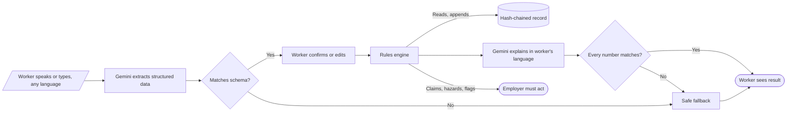
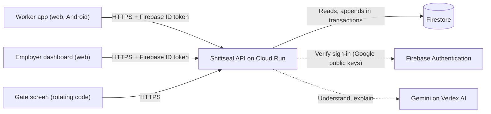
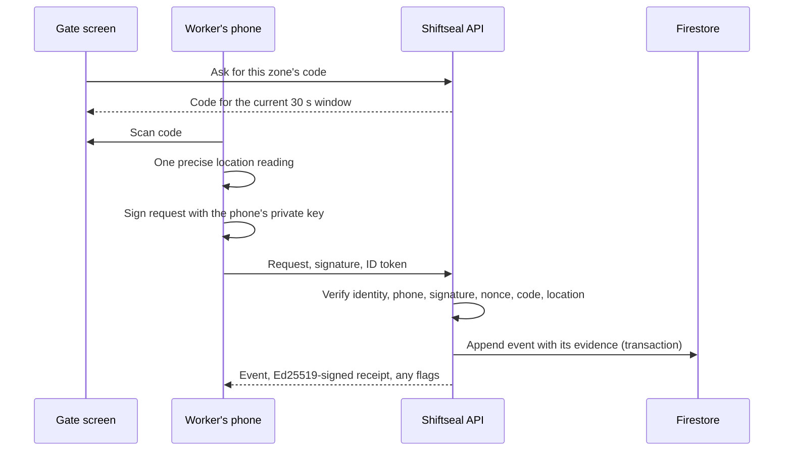

# How Shiftseal works

Shiftseal keeps a shift worker's hours on a record that nobody can quietly change, collects evidence with every record so false claims from either side show up, and uses AI only where it is good at something: understanding people.

Diagrams: [FigJam system model](https://www.figma.com/board/DXbOejYuuG4GDZP0KnsHtc) · UI designs: [Figma](https://www.figma.com/design/viMV0sdG4YQXTDyAN6qucK)

## The one rule

**The AI understands. Code decides. Nothing reaches a worker unchecked.**



1. **Understand.** Gemini turns speech or text, in any of the app's languages or a mix, into a fixed JSON shape. Output is schema-constrained and validated again with zod.
2. **Decide.** Hours, overtime, pay, claim matching, hazard severity and evidence flags are plain, tested functions in `src/shared/rules/`. The AI never produces a number used for money or safety.
3. **Check.** When the AI explains a payslip, every number in its answer is compared with the computed values (`factcheck.ts`); one mismatch and a template is shown instead. If feedback cannot be anonymised, nothing is saved.

## Components



| Part | Where | What it does |
| --- | --- | --- |
| Worker app | `src/client/worker/` | Home, check-in flow, Pay, Report, Speak up, shift receipts. Holds the phone's signing key and a copy of its own record. Queues checks when offline. |
| Employer app | `src/client/employer/` | Setup, invites and posters, gate screen, dashboard, people and wages, review of claims, hazards and flags. |
| Sign-in | `src/client/auth/`, `src/server/auth/` | Firebase phone (SMS code) and Google sign-in; the server verifies every ID token and loads the caller's role from their membership. |
| API | `src/server/routes/` | `account.ts` (profile, workplaces, invites), `workplace.ts` (members, phones, gate codes, checks, corrections), `reports.ts` (overview, dashboard, claims, hazards, feedback, pay, flags, AI), `leave.ts`, `complaints.ts`. |
| Languages | `src/shared/languages.ts`, `src/client/i18n/` | One list of supported languages used by the client, the API schemas and the AI prompts. Worker strings per language in `i18n/locales/`; a test checks every language has every string with the same placeholders. |
| Countries | `src/shared/countries/` | One pack per country (India, Japan, South Korea, China, France, Germany, Spain, Mexico, Brazil, Portugal, UK, US with California and New York): normal hours, overtime bands, rest-day, holiday, night and Sunday premiums, pay deadline, leave types and statutory leave by service, who must receive harassment complaints and outside bodies, legal limits, yearly payments. Every number cites its statute. |
| Rules | `src/shared/rules/` | `hours` (prices hours by the country's bands, counting weekly, monthly and yearly thresholds), `pay`, `limits`, `claims`, `severity`, `fatigue`, `burnout`, `leave`, `anonymity`, `factcheck`, `flags`. A rule is looked up in the state, then the country, then the sector's policies (`rules/rulesets/`), then common wellbeing policies. |
| Record | `src/shared/ledger/ledger.ts` | SHA-256 hash chain per worker: `CHECK_IN`, `CHECK_OUT`, `EDIT`, `LEAVE`. Nothing is overwritten. |
| Leave | `src/server/routes/leave.ts`, `rules/leave.ts` | The country's leave types, paid or unpaid, counted in working or calendar days as its law does. Requests, decisions, cancellations and withdrawals are sealed into the worker's chain. Employer allowances can exceed the statutory minimum, never fall below it. Work-from-home days relax the site check. |
| Complaints | `src/server/routes/complaints.ts` | Harassment complaints to the people the country's law requires (India's Internal Committee, Japan's 相談窓口, ...). Readable only by the complainant and the handlers they did not exclude; never sent to the AI; the owner sees counts only. |
| Languages | `src/shared/languages.ts`, `src/client/i18n/` | Locales carry a country (English India/UK/US, Spanish Spain/Mexico, Portuguese Brazil/Portugal). Text is looked up in the workplace country's wording first (in the reader's language, else English), then the locale's spelling, then the language. A test checks every language and country has every string. |
| Storage | `src/server/data/` | `Repo` interface; Firestore in production, memory in tests and local development. |

### Data layout (Firestore)

```
users/{uid}                                  profile and memberships
invites/{code}                               workplace, role, optional phone
workplaces/{wp}                              site boundary, zones, shift times, pay day
workplaces/{wp}/members/{uid}                role, wage, team, approved phone key
workplaces/{wp}/members/{uid}/events/{seq}   the worker's hash chain, one event per document
workplaces/{wp}/{claims|hazards|feedback|notifications|flags|payments|deductions|receipts|photos|leave|complaints}/{id}
workplaces/{wp}/digests/{date}               sealed end-of-day fingerprint
```

Chain appends run in a Firestore transaction that creates the next sequence number, so two simultaneous checks can never fork a worker's record.

## A check-in, step by step



- **Identity:** the Firebase ID token says who is calling.
- **Phone:** the request must be signed by the key registered for this worker. A new phone waits for a supervisor's approval; until then its checks are flagged.
- **Code:** gate codes are HMAC-signed per workplace and change every 30 seconds; three past windows are accepted to allow for delay. Printed codes are fixed and weaker.
- **Location:** compared with the site circle, taking the reading's accuracy into account.
- **Time:** the server's clock, not the phone's. A check queued offline is dated by the gate code it carries (up to 12 hours late) and marked as sent late.
- **Outcome:** every check is recorded with its evidence and a trust level (high, medium, low). Only a request that fails its signature is refused, because it did not come from the worker's phone.

## Why neither side can quietly rewrite the record

- Every event stores the hash of the one before it; changing or removing an old event breaks every later hash.
- A correction is a new `EDIT` event with who, when and a required reason. The worker is told immediately and can dispute it.
- Check-ins are signed on the worker's phone, so the server cannot invent them.
- The server returns a signed receipt for every event, so it cannot later deny accepting one.
- After each day ends, the server seals a signed fingerprint of every worker's record. A later rewrite of anyone's history no longer matches it, or the copies on workers' phones.

## Evidence flags

Flags are produced by `src/shared/rules/flags.ts` and stored per workplace. They say where a claim and the evidence disagree; they never deduct, block or punish.

| About the worker's record | About the employer's record |
| --- | --- |
| Outside the site, imprecise or missing location, mock location | Edit contradicts a signed on-site check |
| | Over one of the country's legal working-time limits |
| Missing, expired or foreign gate code | Hours cut within two days of payday |
| Unapproved phone, failed device check, wrong phone clock | One editor repeatedly cutting hours |
| Claim with no shift, longer than possible, duplicate, uncorroborated | Worker reports being paid less than the payslip |
| Hazard away from its zone, or without a photo | Hazard closed without a photo, or disputed by the reporter |
| | Approved leave withdrawn, salary received after the legal deadline |
| | Nobody named to receive harassment complaints where the law requires it, inquiry past the country's deadline (counts only) |

Workers see every flag about their own records. Nobody can close a flag about themselves; flags about the employer close only by the owner.

## Privacy

- Location is read only at check-in, check-out and hazard reports, never tracked in between.
- Anonymous feedback is cleaned of names, places, times and IDs before saving; the original is never stored; it is linked only to a team, never a person; themes appear only once five people have responded.
- Photos are compressed on the phone and visible only to the uploader and supervisors.

## Students and young workers

A person's studies and age live on their account, not a workplace, because a student visa caps all their jobs together. `src/shared/rules/students.ts` reads the country pack's `students` rules (visa caps for term and breaks, yearly hours or days, under-18 day, week and night limits) and adds every shift the person worked at any of their workplaces (`src/server/services/students.ts`). The results join the worker's legal limit meters; on check-out, going over a cap (`STUDENT_LIMIT`, `MINOR_HOURS`) or an under-18 working inside the night window (`MINOR_NIGHT`) raises a flag for the employer. The employer sees "student", "student visa" or "under 18", never the birth date.

## Android app

`android/` is a small native shell around the same web app, so there is one UI to keep correct. It adds the two things a browser cannot prove:

- **Mock location.** Location comes from the phone's own GPS through Google's fused location provider, which says whether a mock-location app produced the reading. A mocked reading is still recorded and is flagged for review.
- **Play Integrity.** Each check asks Google for a token bound to that check's nonce. The server has Google decode it (`src/server/services/integrity.ts`) and accepts it only if it is this app, installed from Play, on a genuine device, for this check, within five minutes. Web check-ins, and Android ones before the Play Console is linked, record `unavailable`: lower trust, never blocked.

The page talks to the phone through one bridge (`window.ShiftsealAndroid`, see `src/client/lib/native.ts` and `Bridge.java`). The app loads only the Shiftseal origin and the bridge answers only that origin; any other link opens in the browser. Gate QR links (`/c`) open in the app once `/.well-known/assetlinks.json` lists its signing certificate.

## Still to build

- **Push notifications** (Firebase Cloud Messaging); the apps poll for now.
- **Anchoring daily fingerprints** somewhere neither side controls.
