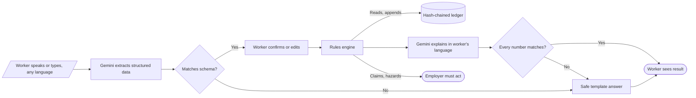
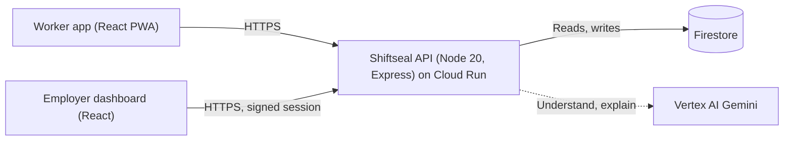
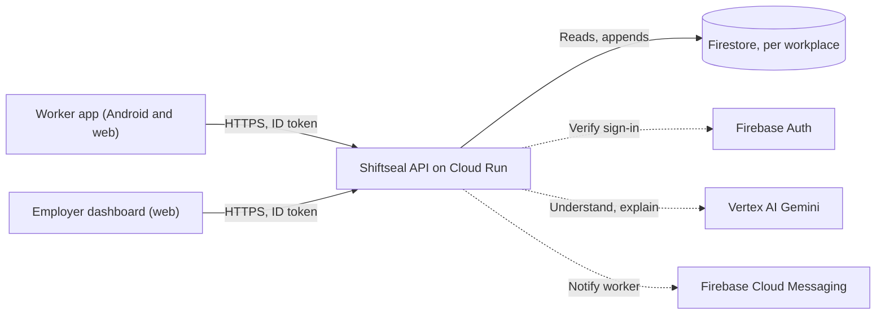

# How Shiftseal works

Shiftseal keeps a shift worker's hours on a record that nobody can quietly change, and uses AI only where it is good at something: understanding people. This document is the system model. It covers what exists today and, separately, what the next version changes.

Diagrams: [FigJam system model](https://www.figma.com/board/DXbOejYuuG4GDZP0KnsHtc) · UI designs: [Figma](https://www.figma.com/design/viMV0sdG4YQXTDyAN6qucK)

## The one rule

**The AI understands. Code decides. Nothing reaches a worker unchecked.**

1. **Understand.** Gemini turns free speech or text (Tamil, Hindi, English or a mix) into a fixed JSON shape: a date and hours for a claim, a hazard type for a report. The output is constrained by a schema and validated again with zod. If it does not fit, it is discarded.
2. **Decide.** Hours, overtime, pay, claim matching and hazard severity are computed by plain, tested functions in `src/shared/rules/`. The AI never produces a number that is used for money or safety.
3. **Check.** When the AI explains something (for example, a payslip), `factcheck.ts` extracts every number in its answer and compares it with the computed values. One mismatch and the answer is replaced by a template.

## Components today

| Part | Where | What it does |
| --- | --- | --- |
| Worker app | `src/client/worker/` | Home, Pay, Report, Speak up. Keeps its own copy of the worker's shift chain in local storage. Polls every 5 s. |
| Employer dashboard | `src/client/admin/` | Hazards, hotspots, fatigue, claims, shift edits with reasons. |
| API | `src/server/` | Express, helmet CSP, rate limits (180/min API, 20/min AI), zod-validated config, graceful shutdown. |
| Rules | `src/shared/rules/` | `hours`, `pay`, `claims` (±15 min tolerance), `severity` (floor per hazard type), `fatigue`, `anonymity` (k = 5), `factcheck`. Each workplace type is a JSON ruleset in `rules/rulesets/`. |
| Ledger | `src/shared/ledger/ledger.ts` | SHA-256 hash chain per worker. Events are `CHECK_IN`, `CHECK_OUT`, `EDIT`. Nothing is overwritten. |
| AI | `src/server/gemini/` | Vertex AI with the service account (no API key). 15 s timeout, 2 attempts, labelled fallbacks if Gemini is unavailable. |
| Storage | `src/server/store/` | One `Store` interface, two implementations: Firestore in production, memory in tests. |

### API

| Route | Who | Purpose |
| --- | --- | --- |
| `GET /api/worker/:workerId/overview` | Worker | Shifts, chain, payslip, claims, notifications |
| `POST /api/worker/check-in-out` | Worker | Appends a check-in or check-out event |
| `POST /api/worker/notifications/respond` | Worker | Accept or dispute an edit |
| `POST /api/worker/claims` · `/hazards` · `/feedback` | Worker | Submit a claim, hazard report or anonymous feedback |
| `POST /api/ai/claim` · `/hazard` · `/explain-pay` · `/feedback-preview` | Worker | AI extraction and explanation (checked as above) |
| `POST /api/session/admin` | Employer | Issues an 8-hour HMAC-signed session scoped to one workplace |
| `GET /api/admin/dashboard/:workplaceId` | Employer | Dashboard data |
| `POST /api/admin/shifts/edit` · `/disputes/resolve` · `/hazards/status` | Employer | Edit with a reason (notifies the worker), resolve claims, update hazards |

## How the record stays honest

- Every event stores the hash of the event before it. Changing or deleting an old event breaks every hash after it, and `verify` reports exactly where.
- A correction is a new `EDIT` event with who, when and a required reason. The worker is notified and can dispute it.
- The worker's phone keeps its own copy of the chain. If the server's chain is ever rebuilt, it will no longer match the phone.
- Limit: the server still holds the authoritative chain. Signed receipts on the worker's device, or anchoring chain heads somewhere neither side controls, would close that gap.

## Privacy

- Anonymous feedback is cleaned of names, places, times and IDs before it is saved, and the original text or audio is never stored.
- A team's feedback themes are shown only once five people have responded (k-anonymity), and it is never used to judge an individual.

## What changes in the next version

The hackathon build signs people in with demo accounts. The next version replaces that with real accounts and ships as an Android app as well as on the web.

| Area | Today | Next |
| --- | --- | --- |
| Worker sign-in | Pick a demo account | Phone number and SMS code (Firebase Auth) |
| Employer sign-in | Pick a workplace | Google or email account, then create a workplace |
| Joining | Seeded | Worker scans the site QR or enters an invite code |
| Roles | Admin session per workplace | Owner, supervisor, worker, checked on every request from the ID token |
| Data | One Firestore document | `workplaces/{id}`, `workplaces/{id}/workers/{uid}`, `.../events`, `claims`, `hazards`, `feedback` |
| Updates | Polling every 5 s | Push notifications (FCM), polling only as a fallback |
| Distribution | Web | Web, plus an Android app on Google Play (closed test first) |

The rules engine, ledger and AI checks stay the same. Only identity, storage layout and delivery change.
