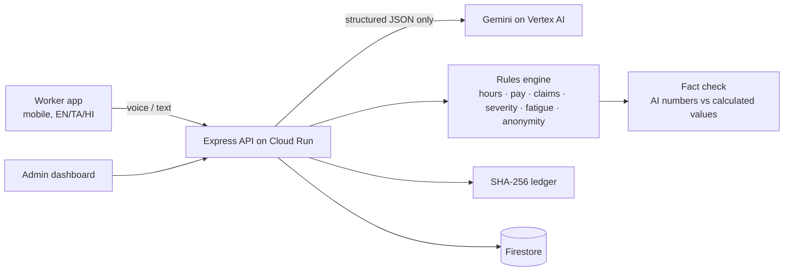

# Shiftseal: a FairShift decent work platform (SDG 8)

**Every hour counted. Every rupee explained.** Proof of work for the world's shift workers.

[](https://github.com/SushilRaj0177/shiftseal/actions/workflows/ci.yml)

**Live app (Google Cloud Run):** https://shiftseal-872210045960.asia-south1.run.app

> **Principle:** The AI understands. Code decides. Nothing reaches a worker unchecked.

---

## 1. Chosen vertical

**UN SDG 8, Decent Work and Economic Growth**, Prompt Wars problem statement **"FairShift: Decent Work Platform"**.

Large workforces in **construction, colleges and schools, hospitals and factories** still run on paper registers, spreadsheets and WhatsApp groups. The problem statement lists these pain points; Shiftseal targets each one directly:

| Pain point (from the problem statement) | How Shiftseal solves it |
|---|---|
| **Opaque pay calculations**: unclear salary breakdowns or **uncounted overtime hours** | Tamper-evident shift receipts, a line-by-line payslip with the rule behind each line, voice overtime claims checked against the receipts |
| **Fear of identification** when raising complaints or giving honest feedback | Gemini removes identifying details before saving; the original voice and words are never stored; a team's feedback is only shown once 5 or more people have responded |
| **Unreported safety risks**, ignored until actual injuries occur | QR zone reports by voice, a severity floor the AI cannot lower, deadlines with auto-escalation, near-miss hotspots by zone |
| **Zero workforce visibility** for employers: overworked or unhappy staff | Fatigue signals (days in a row, 7-day hours, short rest gaps) with readable reasons |
| **High attrition risk**: can't spot staff likely to quit | Attrition signals from overtime trend, missed shifts and disputes. Anonymous feedback is **never** used for any individual signal. |
| **Delayed escalation**: issues reach management only when severe | Disputes must be resolved before payday; hazards past their deadline escalate; the admin dashboard updates live |
| **Regional languages, limited literacy, basic smartphones** | Tamil, Hindi and English throughout, voice input, read-aloud on every key card, icon + text actions, about 78 KB gzipped JavaScript, no heavy UI libraries |

**Deliverables:**
- **More than 3 working features** (section 3).
- **Two interfaces:** a mobile-first worker app (`/worker`) and an employer/admin dashboard (`/admin`).
- **At least 2 industries:** a construction site and college campus facilities, with hospitals described as a third (section 5).

---

## 2. Approach and logic

On a construction site, a worker's hours live in a register the employer controls. If a checkout of 20:40 becomes 18:00, the worker loses overtime and has no way to prove it.

Shiftseal splits the work between AI and code:

- **Gemini (on Vertex AI) only *understands*.** It turns messy Tamil, Hindi, English or mixed-language voice and text into **structured JSON**: an overtime claim, a hazard report, a de-identified piece of feedback, or a plain-language payslip explanation.
- **Deterministic, unit-tested TypeScript *decides*.** Hours, overtime, pay, whether a claim is supported, hazard severity, fatigue limits and anonymity thresholds are all pure functions in `src/shared/rules/`. Each one cites a rule from a JSON ruleset, marked **law** or **workplace policy**.
- **Nothing reaches a worker unchecked.**
  - When Gemini explains a payslip, every number it states must match a value the rules engine calculated (`factcheck.ts`). Any mismatch, or any number it doesn't cite, means the AI text is discarded and a template answer is shown instead.
  - Hazard severity is `max(AI severity, rule floor)`.
  - Overtime claims are only "supported" if the shift receipts prove them.

---

## 3. How the solution works (features)

1. **Tamper-evident shift receipts** (`src/shared/ledger/ledger.ts`)
   - Every check-in and check-out is chained to the previous one: `hash = sha256(prevHash + canonicalJSON(event))`.
   - The worker's phone keeps a copy of the chain and checks it itself with `crypto.subtle`.
   - Employers can only correct a record by **adding** an `EDIT` event with a mandatory reason. The worker is notified at once in their own language and can tap **I disagree**, which opens a dispute.
2. **Voice overtime claims checked against evidence** (`claims.ts`)
   - Example: "I stayed 2 extra hours on Saturday to pour the slab", in Tamil. Gemini returns `{date, extraHours, reason}`.
   - Code matches the claim against the receipts (±15 min tolerance) and marks it **supported**, **partly supported** or **unsupported**. Anything not fully supported becomes a dispute the admin must resolve before payday.
3. **A payslip anyone can understand** (`hours.ts`, `pay.ts`)
   - Normal hours, daily and weekly overtime (never counted twice) at 2×, and deductions. A deduction without a reason is flagged.
   - Each line has a rule badge, and there's a read-aloud button.
   - **Ask why** answers with Gemini and shows a "Checked against your shift record" badge.
4. **QR zone safety reports** (`severity.ts`)
   - A worker scans a zone sticker (or picks the zone) and speaks. Gemini classifies the hazard; the code applies the severity floor.
   - Each report gets a deadline with a countdown, and escalates automatically when overdue.
   - Near-miss hotspots by zone are drawn as an inline SVG chart.
5. **Truly anonymous feedback** (`anonymity.ts`)
   - Gemini removes names, places, times, phone/ID numbers and personal details. The worker sees the cleaned text before sending.
   - The original is never stored or logged; this is tested with store and console spies.
   - Themes are only shown once 5 or more people in a group have responded.
6. **Employer dashboard:**
   - disputes before payday;
   - hazards sorted by deadline;
   - hotspots;
   - fatigue and attrition signals with reasons;
   - overtime owed;
   - attendance;
   - feedback themes;
   - shift corrections with a required reason;
   - printable zone QR codes.

   It refreshes every 5 seconds, so a worker's report appears within seconds.

### Architecture



### Google services used
- **Gemini 3.8 Flash on Vertex AI:** structured output with JSON schemas, audio understanding, `gemini-3.5-flash` as the retry fallback. The service signs in with its service account, so **no API key exists anywhere.**
- **Google Cloud Run:** hosts the app (asia-south1).
- **Cloud Firestore:** stores data (Native mode).
- **Cloud Build and Artifact Registry:** build from source.
- Built with **Google Antigravity**.

---

## 4. AI evaluation (live, real Gemini)

We ran the deployed app's AI routes against real inputs in Tamil, Hindi, English and code-mixed "Tanglish"/"Hinglish". We used the preview endpoints, so no data was written.

| Task | Result |
|---|---|
| Overtime claim extraction (date + hours, including relative dates such as "last Saturday" and "yesterday") | **10 / 10 correct**, 0 demo fallbacks |
| Hazard type classification across both industries | **9 / 10 correct** |
| Payslip explanations reaching a worker with an unverified number | **0**: every answer is fact-checked, and failures fall back to a template |

Even when the model is wrong, the design limits the damage: claims are checked against receipts, severity has a floor, and money is never computed by the model.

---

## 5. Industries (cross-sector adoption)

Each industry is a **configuration, not a code fork**: a ruleset JSON, zones, hazard types and shift patterns.

- **Construction site ("Tower B")**
  - Day shifts, with overtime on slab pours.
  - Zones: Scaffold A/B, Basement, Crane bay, Site gate.
  - Hazard floors: electrical, fall from height, scaffold, structural collapse, crane lifting, fire.
- **College campus facilities**
  - Housekeeping, plus security guards on rotating 12-hour day and night shifts (fatigue matters most here).
  - Zones: Hostel Block A, Academic Block, Cafeteria kitchen, Labs, Main gate.
  - Hazard floors: electrical, fire, gas leak, chemical lab, fall from height, violence with a weapon.
- **Hospitals (third use case):** round-the-clock care and sanitation teams. It works the same way: rotating shifts, ward zones, needle-stick and chemical hazards with high floors, and fatigue rules for night rotations.

---

## 6. Assumptions

- **Labour rules:**
  - Legal defaults follow India's labour codes (OSH Code 2020, Code on Wages 2019): **8 h/day and 48 h/week normal hours, overtime at 2× the ordinary rate, a weekly rest day.**
  - Acts are cited by name. Thresholds are configurable per state and sector in `src/shared/rules/rulesets/*.json`.
  - Values marked `"policy"` (rest gaps, fatigue limits, hazard deadlines, the deduction-reason requirement) are **employer settings, not law**, and the UI labels them that way.
- **Pay:** wages are the employer's agreed hourly or daily rate. **We don't claim statutory minimum-wage figures without a verified source.**
- **Sign-in:** the demo sign-in issues a signed admin session per workplace instead of asking for a password. Every admin route verifies the token's signature, expiry and workplace on the server.
- **Demo data:** about 16 workers across 2 workplaces with 3 weeks of shifts. Today is fixed at 27 Oct 2026, so the stories (an edited checkout, a fatigue case, the Scaffold B hotspot) are reproducible.
- **Without Gemini:** if Gemini is unavailable, every AI feature uses a clearly labelled **"Demo response"** so the app never breaks. Numbers still come from the rules engine.
- **Photos:** these are optional, compressed on the phone, and only their description is used.

---

## 7. Security, accessibility and testing

- **Security:**
  - No secrets in the repo or its history.
  - Vertex AI uses the service account (no keys).
  - Admin routes require an HMAC-SHA256 signed, expiring, workplace-scoped session (`Authorization: Bearer`), verified with a constant-time comparison. Role headers are never trusted.
  - The container runs as the non-root `node` user.
  - zod validation on every request.
  - helmet with a strict CSP, rate limits (AI routes 20 per minute), upload size limits.
  - Generic error messages, with logs that contain only the error type and status, never content.
  - Feedback content is never logged.
- **Accessibility:**
  - Semantic landmarks, a skip link, and labels linked to every input.
  - `aria-live` for AI results and `lang` switching for Tamil and Hindi.
  - Visible `:focus-visible`, Esc closes sheets, and everything works by keyboard.
  - WCAG AA contrast, `prefers-reduced-motion` respected, read-aloud.
- **Testing:**
  - **71 Vitest tests in 12 files:** hours (night shifts, no double-counted overtime), pay, ledger tamper detection, claims tolerance, severity floor, anonymity threshold, fact check, fatigue, zod schemas.
  - API tests with Gemini mocked: admin routes reject missing, spoofed, tampered and wrong-workplace sessions, feedback never stores the original, a fact-check failure falls back to the template.
  - CI runs lint, tests and the build on every push.

```bash
npm ci
npm test        # 71 tests
npm run lint
npm run build
npm start       # http://localhost:8080 (STORE=memory by default)
```

**Deploy:** see [`DEPLOY.md`](DEPLOY.md). The app deploys to Cloud Run from source, using Vertex AI environment variables and no API key.
